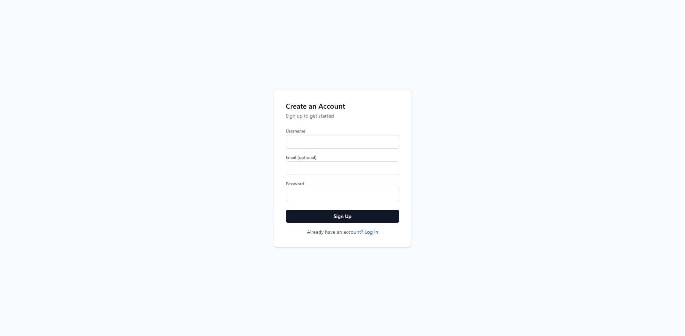
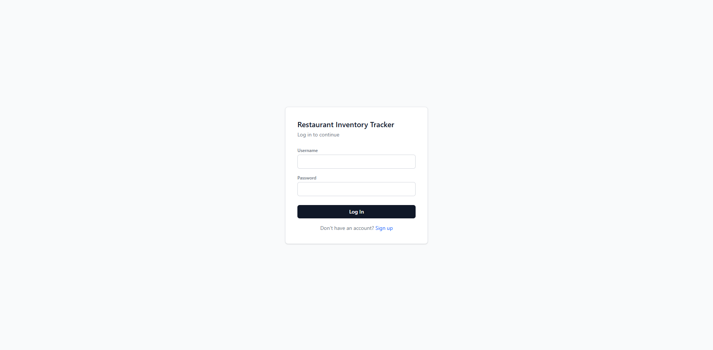
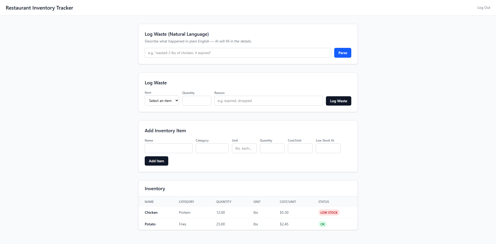

# Restaurant Inventory & Waste Tracker

A full-stack inventory and waste-tracking app for restaurant back-of-house teams. This app lets staff log waste in plain language — "wasted 3 lbs of chicken, because it expired" — and an AI parses it into a structured record automatically, instead of making them navigate a form.

The problem is one I saw firsthand working back-of-house at Chick-fil-A: waste tracking exists on paper or gets skipped entirely because it's slow. This app is my attempt at fixing that.

**Live app:** [inventory-manager-kappa-two.vercel.app](https://inventory-manager-kappa-two.vercel.app)
## Screenshots





## What it does

- **Authentication** — register or log in with JWT-based auth; each request is authenticated via a bearer token.
- **Inventory dashboard** — view current stock levels, cost per unit, and automatic low-stock flagging when an item drops below its threshold.
- **Add inventory items** directly from the app.
- **Manual waste logging** — a straightforward form to log wasted quantity and reason against any inventory item.
- **AI-powered waste logging** — type a plain-English sentence describing what happened, and Claude's API extracts the item, quantity, unit, and reason. Fuzzy matching (via RapidFuzz) resolves casual phrasing against real inventory names. If the AI can't confidently match an item, it doesn't guess — it falls back to asking the user to use the manual form instead.
- **Automatic stock adjustment** — logging waste decreases an item's quantity; the same logic exists for restocks.

## Tech stack

**Backend:** Django, Django REST Framework, Simple JWT, PostgreSQL (production) / SQLite (local development), Gunicorn, WhiteNoise, deployed on Render.

**Frontend:** React (Vite), Tailwind CSS, Axios, deployed on Vercel.

**AI:** Anthropic's Claude API (`claude-haiku-4-5`) for natural-language extraction, RapidFuzz for fuzzy string matching against inventory data.


## Running it locally

**Backend:**

```bash
python -m venv env
source env/bin/activate  # or env\Scripts\activate on Windows
pip install -r requirements.txt
python manage.py migrate
python manage.py createsuperuser
python manage.py runserver
```

Create a `.env` file in the project root with:

```
ANTHROPIC_API_KEY=your-key-here
DEBUG=True
```

**Frontend:**

```bash
cd frontend
npm install
npm run dev
```

Create a `frontend/.env` file with:

```
VITE_API_URL=http://127.0.0.1:8000/api
```

## Known limitations

- Registration is currently open to anyone who finds the live URL — there's no invite or approval step, which would be necessary for real restaurant use but is a reasonable simplification for a portfolio demo.
- All authenticated users currently share one inventory rather than each having their own — per-account scoping is a planned enhancement.
- Inventory quantity isn't currently prevented from going negative if logged waste exceeds recorded stock.

## Author

Built by Ishmaiah Etienne — [LinkedIn](https://www.linkedin.com/in/ishmaiah-etienne-408a26269) · [GitHub](http://github.com/ishcode10)
